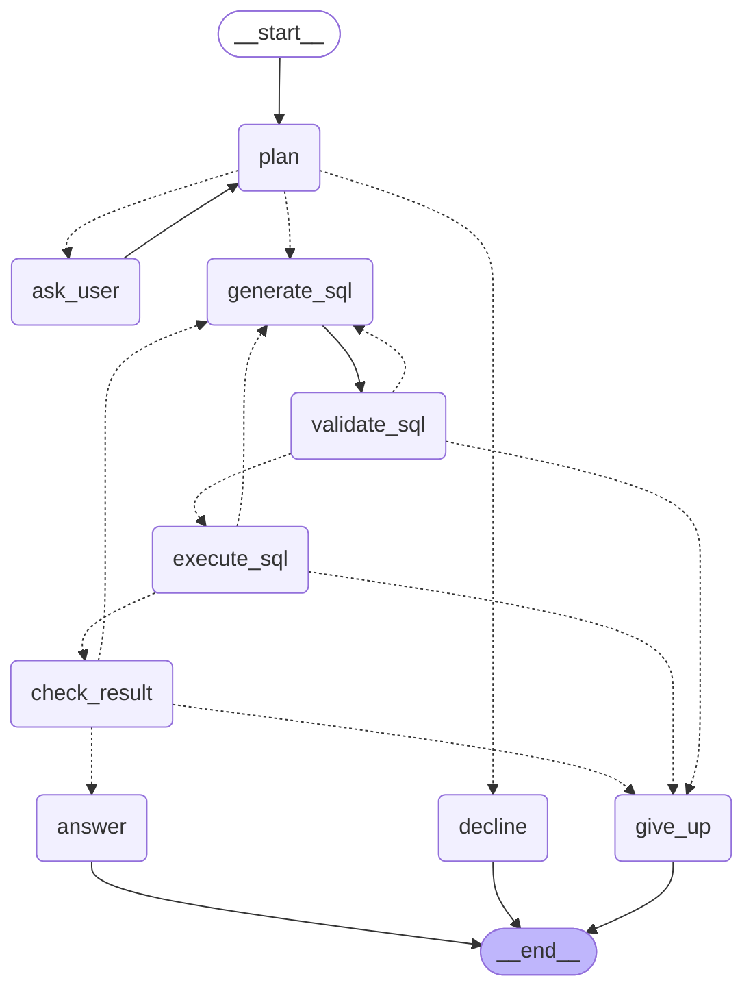

# University QA Agent

Ask a question about a university database in plain English: "Which teacher had the
highest average grade in Fall 2025?". A LangGraph agent plans the question (1-3 steps),
writes one SQL query per step, checks the query, runs it on a **read-only** SQLite
connection and writes the answer **only from the rows it got back**. Vague questions pause
the graph to ask the user, and write requests are declined. Every run is traced to LangSmith
and to a local `traces/<run_id>.jsonl` file.

Stack: Python 3.11, LangGraph, langchain-openai (`gpt-4.1-mini`), SQLAlchemy + SQLite, pytest, LangSmith.

## The graph

Generated from the compiled graph (`build_graph(...).get_graph().draw_mermaid()`). Dotted
lines are conditional edges.



- **plan** decides `answerable` (1-3 steps), `needs_clarification` (→ `ask_user`, which
  pauses with `interrupt()`, then plan again, at most once) or `out_of_scope` (→ `decline`, no SQL).
- **Error loop:** a failure in validate / execute / check goes back to `generate_sql` with
  the error and the failed SQL. Max 3 attempts per step, then `give_up`.
- **check_result** gives an empty result one retry (which may fix mistakes but never widen a
  filter), accepts the step, and moves on to the next step or to `answer`.

All routing is in [src/agent/graph.py](src/agent/graph.py), one short function per decision.

## Run it from zero

```bash
git clone https://github.com/adonis121/langgraph-sql-agent-genpact.git
cd langgraph-sql-agent-genpact
python3.11 -m venv venv
source venv/bin/activate
pip install -r requirements.txt
cp .env.example .env          # then set OPENAI_API_KEY; for LangSmith also set
                              # LANGSMITH_API_KEY and LANGSMITH_TRACING=true

python -m src.db.build_db     # builds db/university.db from db/schema.sql + db/seed.sql
```

Ask a question (real model):

```bash
python -m src.main "How many students failed at least one course?"
```

It prints the plan, each step's SQL and row count, the answer, the run id and the trace path.
Read the trace as a timeline:

```bash
python -m src.show_trace traces/<run_id>.jsonl          # path printed by src.main
python -m src.show_trace traces/examples/multi-step.jsonl   # committed example, no API key needed
```

Tests (fake LLM, no API calls, no key needed):

```bash
pytest
```

Eval (real model, 10 questions, about a minute; prints the score and rewrites
[docs/eval-report.md](docs/eval-report.md)):

```bash
python -m src.eval
```

## Design decisions

| Decision | Why |
|---|---|
| **Fixed workflow, not a ReAct agent** | Every run takes a path you can read in `graph.py`. Retries, limits and the give-up point are code, not model choices, so the system is easy to test (one e2e test per path) and to explain. The model only does what it is good at: planning, writing SQL, writing the answer. |
| **Read-only DB is the security boundary** | `connect_readonly` opens SQLite with `mode=ro` and `PRAGMA query_only = ON`. `validate_sql` (SELECT/WITH only, one statement, no write keywords, add LIMIT) is a correctness guardrail that gives the model errors it can fix. A keyword denylist is never complete, so it is not what protects the data. See [docs/sql-validation-and-security.md](docs/sql-validation-and-security.md). |
| **Planner + multi-step** | Hard questions are split into 1-3 steps, one SQL query each. Later steps see earlier steps' SQL and results (e.g. step 2 uses `teacher_id = 3` from step 1). This keeps each query small, and each step shows up on its own in the trace. The planner also rejects write requests before any SQL is generated. |
| **`ask_user` is its own node** | On resume, LangGraph re-runs the interrupted node from the start. If `interrupt()` were inside `plan`, the planner LLM would run again and could decide differently. A separate node with no LLM call makes the re-run free. |
| **`results` holds only accepted results** | Only `check_result` appends (through an `operator.add` reducer). Failed or retried queries never reach the answer or later steps. They are still in the trace. |
| **Eval compares results, not SQL** | Many different queries are correct. The eval runs a hand-written reference query and compares rows: column names and order are ignored, extra agent columns are allowed, numbers are rounded. See [docs/eval-report.md](docs/eval-report.md). |
| **DB-agnostic agent code** | `src/agent` contains no table names. The schema comes from the SQLAlchemy inspector, the dialect from the engine, and the business rules (pass mark 60, NULL = not graded, current semester) from [config/university_notes.md](config/university_notes.md). |
| **Plain-text LLM interface** | Every node calls `llm.invoke(prompt).content`. The planner returns JSON that is checked with Pydantic. The fake LLM in tests is then just a list of strings. |

## Project layout

| Path | What |
|---|---|
| `src/agent/` | `graph.py` (wiring + routing), `state.py`, `nodes.py`, `planner.py`, `prompts.py` (all prompts), `sql_validation.py`, `llm.py` |
| `src/db/` | `database.py` (read-only connection, schema as text, run query), `build_db.py` |
| `src/tracing.py`, `src/show_trace.py` | Traced run (LangSmith + JSONL), timeline viewer |
| `src/eval/` | Eval questions with reference SQL, result comparison, runner |
| `src/main.py`, `src/config.py` | CLI, settings (`DATABASE_URL`, `NOTES_PATH`) |
| `db/` | `schema.sql`, `seed.sql` (with edge cases: same names, failing and NULL grades, a course with no students) |
| `config/university_notes.md` | Business rules for this database (the only university-specific input) |
| `tests/` | Unit tests, routing, prompts, e2e graph tests with a fake LLM |
| `traces/examples/` | Curated real runs |
| `docs/` | Design notes, eval report, examples, limitations, production notes, session history |

## Documentation

- [docs/examples.md](docs/examples.md): 7 real runs with their SQL, results and answers
- [docs/eval-report.md](docs/eval-report.md): eval score (9/10) and the failure analysis
- [docs/planner-and-multistep.md](docs/planner-and-multistep.md): planner, interrupt, multi-step, **the bug found through a trace**, running on another database
- [docs/sql-validation-and-security.md](docs/sql-validation-and-security.md): what is validated and what really protects the data
- [docs/tracing.md](docs/tracing.md): trace format and how to read a trace
- [docs/known-limitations.md](docs/known-limitations.md): what doesn't work, or only partly works
- [docs/production.md](docs/production.md): what exists now and what production would need
- [traces/examples/README.md](traces/examples/README.md): the example traces
- [docs/agent-sessions/](docs/agent-sessions/README.md): full Claude Code session history

## Where to start reading the code

1. [src/agent/graph.py](src/agent/graph.py): the whole workflow and its routing on one screen
2. [src/agent/state.py](src/agent/state.py): what flows between nodes
3. [src/agent/nodes.py](src/agent/nodes.py) and [src/agent/planner.py](src/agent/planner.py)
4. [src/agent/prompts.py](src/agent/prompts.py)
5. [src/agent/sql_validation.py](src/agent/sql_validation.py) and `connect_readonly` in [src/db/database.py](src/db/database.py)
6. `python -m src.show_trace traces/examples/multi-step.jsonl`
7. [tests/test_graph_e2e.py](tests/test_graph_e2e.py) with [tests/fake_llm.py](tests/fake_llm.py)
8. [src/eval/compare.py](src/eval/compare.py) and [docs/eval-report.md](docs/eval-report.md)

## AI usage

- Built with **Claude Code**, one session per milestone. Each session started in plan mode:
  the agent proposed a plan, I reviewed and changed it, the agent implemented it, then I
  ran and checked the result before committing.
- The full session history is in [docs/agent-sessions/](docs/agent-sessions/README.md).
- Architecture options and the milestone plan were discussed with **Claude (chat)** first. The
  resulting decisions are in [CLAUDE.md](CLAUDE.md), which the coding agent read at the
  start of every session.
